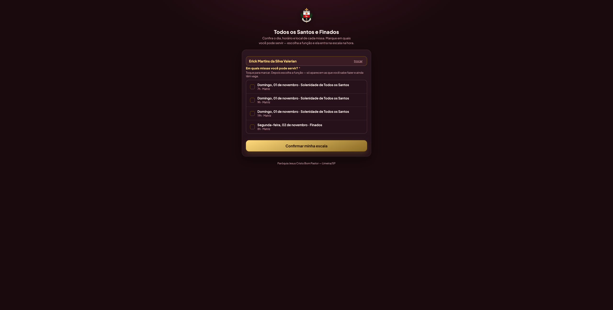
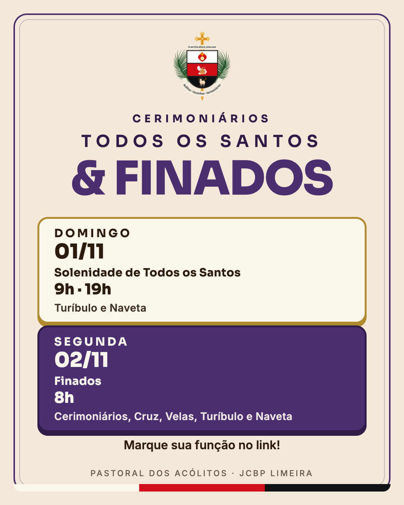
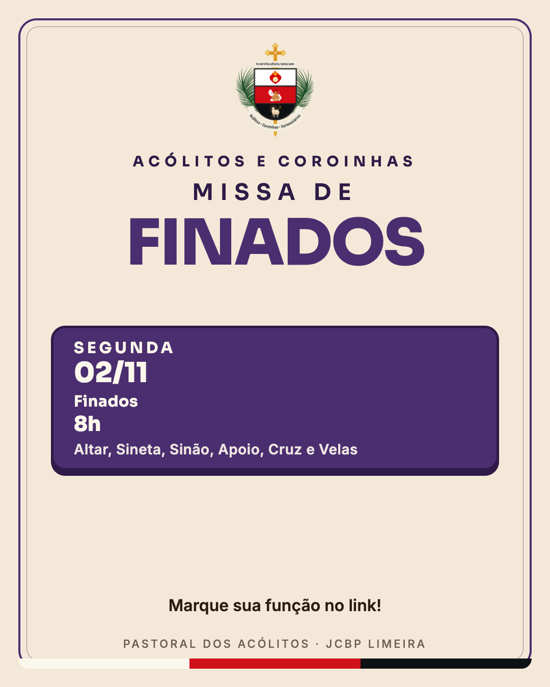
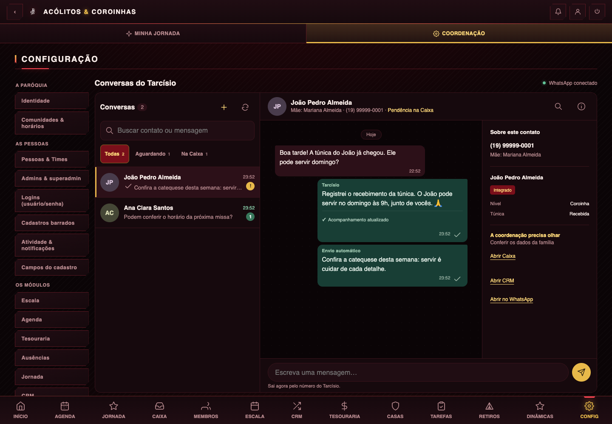

# Checkpoint — 01/11/2026 (sessão de 31/10 a 01/11)

Para retomar: leia este arquivo, depois a seção **6. PRÓXIMO TRABALHO** (medalhas de tempo de serviço).
Tudo abaixo de "No ar" já está publicado e testado. As imagens ficam em `docs/checkpoint-2026-11-01/img/`.

Projeto: `/Users/erickmartins/projetos/iajcbp` (app dos Acólitos/Coroinhas JCBP). Conta GitHub `erickjcbp`, Vercel `erickjcbp-1650s-projects` (ver `CLAUDE.md`: nunca `gh auth switch`/`vercel switch`; Vercel CLI sempre com `--global-config ~/.vercel-iajcbp`). Banco: Supabase `fttjgsotuosjfrasttds`; a URL de conexão está em `.env` (`SUPABASE_DB_URL`), uso `psql "$SUPABASE_DB_URL"`. Robô do Tarcísio na VPS `179.198.107.71` (chave `~/.ssh/sator_whatsapp_gateway_ed25519`).

---

## 1. Liturgia de Finados e Todos os Santos (link `/finados`)

**Link universal:** `https://coroinhas.jcbplimeira.com.br/finados` (e `/novena` abre a mesma página). **Sem login**: o servo digita o nome, marca a missa e escolhe a função.

Como funciona (dado, não código):
- A página `projetos/acolitos/novena-publica.html` lista as celebrações com `novena_publica = true` e `data >= hoje`. As vagas vêm de `acolitos_modelos` pelo `tipo` + `comunidade` da celebração.
- Migration `docs/migrations/126_liturgia_finados.sql`: tipos `finados_domingo` (domingo 01/11, 7h, 9h e 19h, matriz; mesmo modelo da missa comum + turíbulo 1 + naveta 1) e `finados_segunda` (segunda 02/11, 8h, matriz; criada nova). Modelo da segunda: cerimonial de altar 1, de credência 1, missal 1, cruz 1, velas 2, turíbulo 1, naveta 1, **altares 3, sineta 1, sinão 1, apoio 10** (ajustado depois por pedido do dono, direto no banco; o `.sql` já reflete).
- Migration `127_finados_sem_login.sql`: as 3 RPCs `acolitos_novena_publica_*` aceitam chamada anônima **só** para celebrações de tipo `finados_*`; as outras seguem exigindo login (regra da migration 097, de 20/10, que existe porque qualquer pessoa podia mexer na escala dos outros). **Risco aceito pelo dono**: nessas 4 missas qualquer um que ache o nome de um servo marca/troca/tira a escala dele. Dono decidiu **não desligar** depois da missa de segunda.
- Página mostra "Solenidade de Todos os Santos" (domingo) e "Finados" (segunda). Título: "Todos os Santos e Finados". Cor litúrgica: domingo **branco**, segunda **roxo**.

**Avisos no WhatsApp (tabela `tarcisio_envios`, chave `finados-2026:*`):**

| Horário (BRT) | Grupo | Conteúdo | Estado em 01/11 02h |
|---|---|---|---|
| sáb 31/10 19h | os 3 grupos | versão 1 (errada: pedia login, citava domingo nos grupos de pais e acólitos) | enviado |
| sáb 31/10 23h40 | Cerimoniários | arte + domingo e segunda | enviado |
| dom 01/11 08h | Cerimoniários | arte "a partir das 9h" + segunda | pendente |
| dom 12h, 15h, 18h | Pais e Acólitos e Coroinhas | **só segunda**, arte da segunda | pendente |
| dom 17h | Cerimoniários | arte "só 19h" + segunda | pendente |

Cancelados de propósito: versão 1 de 22h, versão 2 de 06h30, o de 05h45 e o de 21h (o robô só envia 08h–21h). Scripts de agendamento: `docs/finados-2026/agendar.sql`, `agendar-v2.sql`, `agendar-v3.sql`, `ajuste-textos-hoje.sql`. Artes (1080x1350, geradas por `docs/finados-2026/arte.mjs` com puppeteer): `docs/finados-2026/arte-finados-*.png`.

**Efeito colateral conhecido (dono: "não precisa" mexer):** os cards da Escala para domingo aparecem como **"Parcial"** porque o modelo `finados_domingo` exige turíbulo e naveta (vagas abertas) e o tipo aparece com o nome técnico. A segunda aparece "Crítica" (vagas abertas de propósito). Voltar ao tipo `missa_comum` tiraria turíbulo e naveta do link.

---

## 2. Conversas do Tarcísio (enviar, apagar, comandos do dono)

Tela: **Configurações › São Tarcísio › Conversas** (`projetos/acolitos/tarcisio-painel.js` função `conversas`, CSS em `tarcisio-painel.css` bloco `.zp-*`).

- **Enviar**: caixa de texto grava `tarcisio_envios` com `tipo='manual'` (`chave_unica 'manual:<uuid>'`). O robô envia **fora da janela 8h–21h e mesmo pausado** (só o manual tem essa exceção). Computador: Enter envia, Shift+Enter quebra linha; celular: botão.
- **Apagar para todos**: menu ⋯ da mensagem → segundo toque confirma → grava `apagar_pedido_em`; o robô chama a Evolution `DELETE /chat/deleteMessageForEveryone/{instancia}` e grava `apagada_em` ou `apagar_erro`. Só mensagens enviadas **depois deste recurso** têm o `external_id` do WhatsApp. Mensagem do contato: só "Ocultar do painel" (`oculta=true`).
- **Nova conversa por número**: botão **+** na lista.
- **Comandos pelo WhatsApp do dono** (`tarcisio_config.numero_conferencia`): `Enviar para <grupo ou número>: texto` e `Apagar [para <destino>]`. Código: `tarcisio-robo/conversa-comandos.mjs` (+ teste), ligado em `entrada-dono.mjs`, `robo.mjs` (etapa "apagar mensagens"), `evolution.mjs` (`apagarParaTodos`), `assistente.mjs` (guarda `external_id` das respostas). Regras: toda palavra do pedido tem de casar com o nome do grupo; número só se a frase inteira for número; `apagar` cancela primeiro envio manual pendente/saindo (janela de 10 min), sem tocar em mensagem antiga.
- Migration `128_tarcisio_conversas_enviar_apagar.sql`: `tipo` aceita `manual`; colunas `external_id`, `apagar_pedido_em`, `apagada_em`, `apagar_erro`, `oculta` em `tarcisio_envios` e (menos `external_id` já existente) em `tarcisio_mensagens`; coordenação só atualiza `oculta` e `apagar_pedido_em` nas mensagens.
- **Testado ao vivo**: enviar uma mensagem para o número do dono e apagar para todos (funcionou). **Não testado com mensagem real**: os comandos escritos pelo dono (cobertos por 197 testes do robô).

**Fatos do robô que enganam (já gravados na memória):**
1. Só envia 08:00–21:00 (`janela_inicio/fim`); 21:00 exato não sai. `pausado=true` trava tudo menos retiro, preparação e manual. Hoje: `pausado=false`.
2. Aviso de grupo **só texto** leva a arte padrão "ATENÇÃO" anexada (regra do robô).
3. **`Dockerfile` e `implantar.sh` copiam arquivo por arquivo**: módulo novo precisa entrar nos dois, senão o robô entra em loop de erro (aconteceu em 01/11). Deploy: `cd tarcisio-robo && VPS_USER=root ./implantar.sh`; depois `ssh ... docker logs wa-tarcisio-robo-1`.

**Pendência de baixa prioridade (aviso de segurança automático):** `apagar` ignora envio manual **pendente há mais de 10 minutos** (só acontece com o robô fora do ar). Remover o limite de 10 min para o estado `pendente` se quiser fechar.

---

## 3. Escala (app)

- **Histórico paginado** (`escala.html`, `loadDados`): com Histórico ligado são 112 missas e 1.101 escalados, e o banco corta em 1.000 por resposta, então faltava gente nas funções. Agora usa `lerTudo` com `.order('id')`. Prova no banco: sem paginar 1.000, paginado 1.101.
- **Semana vigente inteira** (segunda a domingo): missas de sábado já passadas continuam na tela até a semana acabar; ficam **fora do "Gerar" e do "Limpar semana"** (`selSemana`/`futuras`). Depois da semana, só no Histórico.
- **Arte da escala com liturgia conferida por IA**: `arte-escala/liturgico.mjs` ganhou datas fixas (Todos os Santos 01/11, Finados 02/11, Aparecida 12/10, Latrão 09/11, Exaltação da Cruz 14/9, Apresentação 2/2, Transfiguração 6/8, São João Batista 24/6, São Pedro e São Paulo 29/6) que tomam o lugar do domingo do Tempo Comum. `arte-escala/liturgia-ia.mjs` + `api/_liturgia-conferida.js`: antes de disparar a geração (`api/cron-arte.js`, `api/regenerar-arte.js` nos dois caminhos) a IA confere a celebração do domingo e, se discordar do cálculo, grava `acolitos_liturgia_override` (override manual da coordenação **nunca** é sobrescrito; falha da IA nunca trava). Chave: `ANTHROPIC_API_KEY` já existe na Vercel (produção). **Nunca provado em produção** (o gatilho exige segredo); só testes com resposta simulada (`npx vitest run` em `arte-escala`: 42 testes).
- **Arte de 31/10–01/11 refeita** com "Solenidade de Todos os Santos" (era "31º Domingo do Tempo Comum"); `ARTE_DOMINGO=AAAA-MM-DD` em `gerar.mjs` permite refazer um fim de semana específico (comando usado: `PUPPETEER_EXECUTABLE_PATH="/Applications/Google Chrome.app/Contents/MacOS/Google Chrome" ARTE_DOMINGO=2026-11-01 node gerar.mjs` com `.env` carregado). A arte antiga continua nos grupos do WhatsApp (nada foi reenviado). `dados.mjs`: a arte mantém quem estava `escalado/presente/atrasado/ausente`.
- Rótulo "Ano A" aparece também nas festas; ajustar se o dono reclamar.

---

## 4. Tempo de serviço dos membros (feito)

- Migration `129_membros_servindo_desde.sql`: em `acolitos_membros` → `servindo_desde date`, `servindo_desde_ou_antes boolean`, `servindo_desde_fonte` (`planilhas`|`cadastro_app`|`manual`), `escalas_planilhas`, `meses_escalados_planilhas`, `ultima_escala_planilha`.
- Carga de 01/11/2026 (planilhas do Drive, set/2022 a jun/2026, validada pelo dono em relatório HTML): **200 membros com data** = 170 pelas planilhas (**41 "ou antes"**: já na planilha mais antiga, 17/09/2022) + 30 pelo cadastro (entraram depois de 01/06/2026); **4 sem data**. **Armadilha:** o cadastro `2026-06-01` é a **importação em massa** (168 membros), não "entrou agora"; "novo desde o app" = cadastro **depois** de 01/06/2026.
- **Ficha do membro** (`membros.html`, aba Pessoal): "Servindo desde set/2022 ou antes · 4 anos e 1 mês" (tooltip com escalas/meses).
- Arquivos locais (**gitignored, dados de menores, nunca commitar**): `docs/tempo-de-servico/` → `piloto.html` (relatório), `validacoes.json` (o que o dono validou), `raw.json` (nomes e datas extraídos das planilhas; as planilhas em si foram **apagadas** a pedido do dono), `cruzamento.json`, `final.json`, `carga.sql`, scripts Python (`extrair.py`, `cruzar.py`, `cache_raw.py`, `calcular_final.py`, `gerar_html.py`; precisam de `openpyxl` num venv). Fontes originais: Drive `A3 - ACÓLITOS E COROINHAS/ESCALAS` (V1.0, V1.1, V1.2, V1.4 BKP 26.12.25, V1.6).

---

## 5. Decisões do dono ainda sem implementação (resumo)

Ver seção 6. Resto: nada pendente de decisão fora dela.

---

## 6. PRÓXIMO TRABALHO — medalhas de tempo de serviço (C)

### Decisões do dono (01/11/2026), todas aprovadas
- **5 marcos**, concedidos **automaticamente**, **com XP**, **aviso no mesmo dia** da concessão (nada de silencioso) e **retroativos com a data real do marco** (`ganho_em = servindo_desde + N anos`).
- **Nomes e tiers aprovados:**

| Marco | Nome | Cor/tier | XP |
|---|---|---|---|
| 1 ano | **Primeira Chama** | bronze | 30 |
| 2 anos | **Pilar do Tempo** (já existe) | prata | 40 |
| 3 anos | **Raiz da Pastoral** (já existe) | ouro | 50 |
| 5 anos | **Coluna do Altar** (novo) | **platina** (cor nova) | 70 |
| Veterano | **Veterano** (novo significado) | **rosa/ametista**, arte exclusiva | 100 |

- **Veterano** = 5+ anos **e** nível **Acólito Sentinela ou acima** (`acolito_sentinela`, `cerimoniario_aspirante`, `cerimoniario_guardiao`, `cerimoniario_magistral`, `cerimoniario_mor`). Ordem completa dos níveis: `coroinha` < `acolito_aspirante` < `acolito_guardiao` < `acolito_sentinela` < `cerimoniario_aspirante` < `cerimoniario_guardiao` < `cerimoniario_magistral` < `cerimoniario_mor` (há ainda `aspirante` legado).
- **Membros com mais de 5 anos de verdade** (os "ou antes" e quem o dono sabe que entrou antes de 2022): o **dono concede manualmente** os marcos de 5 anos/Veterano pela tela de medalhas da coordenação (RPC `acolitos_medalhas_multiplas`, `projetos/acolitos/medalhas-admin.js`). Por isso a concessão automática precisa ser **idempotente** (a PK `(membro_id, missao_id)` em `acolitos_badge_ganhos` já garante).
- **Onde aparece o marco:** no **canto superior direito do avatar** em **"Minha Jornada"** (home, `projetos/acolitos/index.html`, `buildAvatarEl(m?.foto_url, ...)` por volta da linha 622). Mostrar o **maior marco ganho** (1, 2, 3, 5 ou V).
- **Arte nova** para Primeira Chama, Coluna do Altar e Veterano, no padrão das medalhas atuais (a pasta `projetos/acolitos/medalhas-arte/` tem `*-bronze.webp`/`*-ouro.webp`; `medalhas-arte.js` mapeia). O dono pediu: 5 anos **platina**; Veterano **rosa ametista**.

### O que já existe e o que mudar
- Há **3 medalhas de tempo no banco, 0 concedidas** (contam desde `created_at`, que é 01/06/2026 para todos): `acolitos_missoes`: `0fba3b84-f070-4d67-af7e-c0ddc8086b2d` "Veterano" (12 meses, prata, 30 XP), `6e36739b-7ee6-4772-ba90-e3e2bcf8b256` "Pilar do Tempo" (24, ouro, 40), `e38aba98-bd7a-4279-8f6e-a66a0302a0d9` "Raiz da Pastoral" (36, ouro, 50). Critério `{"fonte":"tenure","meses":N}`.
- A conta está na função SQL `acolitos_progresso_criterio(p_membro uuid, c jsonb)` (ramo `'tenure'`: `select created_at ... <= now() - meses`; texto "Complete N anos" em várias migrations: 119, 121, 124, 125). **Trocar a base por `coalesce(servindo_desde, created_at::date)`** e manter o texto.
- `badge_tier` em `acolitos_missoes` é texto livre (sem CHECK); os esquemas de cor ficam em `shared.js` `PATCH_ESQUEMAS` (~linha 3126): **`ametista` e `rosa` existem**, **`platina` não** (criar, algo como fill `#14181c`, edge `#e5e4e2`/`#9aa3ab`, acc `#ffffff`).

### Plano passo a passo
1. **Dry run antes de tudo**: simular quantos membros mudam de nível com o XP retroativo (XP de 1, 2 e 3 anos soma até 120 por pessoa; ≥1 ano = 127 ativos, ≥2 = 88, ≥3 = 59, ≥5 = 0, Veterano = 0 em 01/11/2026). Ver como o XP vira nível (tabela/regra de níveis em `jornada-core.js` e `acolitos_xp_*`) e mostrar ao dono o impacto.
2. **Migration 130**: (a) atualizar `acolitos_progresso_criterio` (ramo `tenure` pela nova base; novo ramo `tenure_nivel` com `meses` e `nivel_min`); (b) renomear a missão de 12 meses para "Primeira Chama" (bronze, 30 XP), ajustar tiers de Pilar do Tempo (prata) e Raiz da Pastoral (ouro); (c) criar "Coluna do Altar" (60 meses, platina, 70 XP, automática) e "Veterano" novo (`{"fonte":"tenure_nivel","meses":60,"nivel_min":"acolito_sentinela"}`, ametista, 100 XP). Respeitar o padrão das migrations 123–125 (colunas de `acolitos_missoes`).
3. **Concessão retroativa**: inserir em `acolitos_badge_ganhos` com `ganho_em = servindo_desde + N anos` (ver `docs/migrations/119_badges_ganho_em.sql` para o mecanismo) e creditar o XP; **disparar o aviso/celebração no mesmo dia** (hoje o cliente trata `medalha` em `shared.js` ~linha 494, `_celebTipos`). Um aviso em massa no dia da liberação, como o dono pediu.
4. **Marcador no avatar** em Minha Jornada (canto superior direito) e nos cartões onde o avatar já aparece (lista da home, linha ~869 `buildAvatarEl(..., {nivelSlug...})`).
5. **Artes** das 3 medalhas novas + esquema `platina` (pipeline em `medalhas-arte.js` e `projetos/acolitos/medalhas-arte/`); aprovar com o dono antes de publicar.
6. **Testes**: `jornada-core.test.js`/provas em `projetos/acolitos/provas/` (medalhas-*.prova.mjs são o modelo); mobile 360/390, tablet, notebook, TV 2560 (regra de responsividade do dono).
7. Depois de publicar, o dono concede manualmente 5 anos/Veterano aos veteranos de verdade e pode ajustar `servindo_desde` (ainda **não há campo editável** na ficha; hoje só por SQL ou criar o campo).

### Perguntas ainda em aberto (pequenas)
- Os 4 membros sem data de serviço (3 coroinhas + o próprio dono, que não é coroinha): deixar sem medalha de tempo?
- Tornar `servindo_desde` editável na ficha (com `servindo_desde_fonte='manual'`)?

---

## 7. Armadilhas desta sessão (não repetir)
- `psql` com `tipo` gerado: `acolitos_celebracoes.minutos` é coluna **gerada** (não inserir).
- `read-only` do openpyxl não lê dimensões; abrir sem `read_only`.
- Regex multilinha em teste/arquivo: quebrou um arquivo de teste; reescrever o arquivo limpo é mais seguro.
- Vercel `api/*.js` usa ESM dentro de pacote `commonjs`: módulos `.mjs` entram por `import()` dinâmico dentro de `try`.
- Robô e janela: ver seção 2. Subir módulo novo sem atualizar `Dockerfile` derruba o robô.
- Dados de menores nunca vão para o git (`docs/tempo-de-servico/` está no `.gitignore`).

## 8. Commits da sessão (principais, mais recentes primeiro)
`7201e3d` ficha "Servindo desde" · `6e2c8ab` migration 129 · `018e5d0` liturgia IA + datas fixas · `ad675d9` semana vigente inteira · `d8f58fb` Histórico paginado · `01076d3`/`9352d1f` ajustes do `apagar` · `3f30571` Dockerfile · `23a6595` conversas + comandos do dono · `609e8b1`..`92e8072` artes e avisos de Finados · `13ed4d0` `/finados` sem login · `9279c41`..`ffd0ec0` link de Finados/rota.

## 9. Memória do Claude (já atualizada)
`project_tarcisio_conversas_enviar_apagar.md` e `project_tempo_de_servico_membros.md` em `~/.claude/projects/-Users-erickmartins/memory/` (índice `MEMORY.md`).
